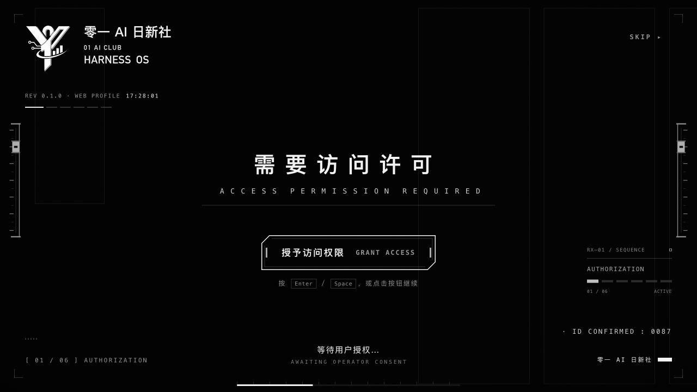
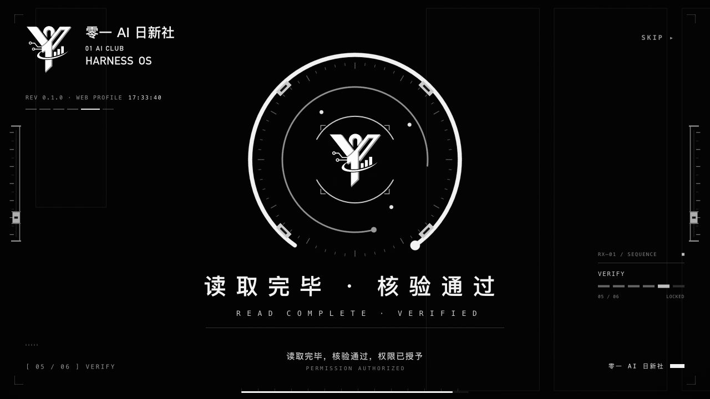

<h1 align="center">⚙️ 零一·环轨启序</h1>

<p align="center">
  <strong>零一 AI 日新社 · 社员专属 DSH 开场动效</strong>
</p>

<p align="center">
  让每一次启动，都成为从想法走向实践的起点。
</p>

<p align="center">
  
  
  
</p>

<p align="center">
  <a href="#purpose">🎯 项目主旨</a> ·
  <a href="#preview">🖼️ 动效一览</a> ·
  <a href="#getting-started">🚀 本地预览</a> ·
  <a href="https://github.com/XiaoSiKe/zero-one-orbit-intro/releases">📦 下载 Release</a>
</p>

<p align="center">
  
</p>

---

<a id="purpose"></a>

## 🎯 项目主旨

**这是零一 AI 日新社专为社员制作的 DSH（DeepSeek Harness）开场动效，也是一份放进日常工具里的社团归属感。**

我们希望，社员每次打开 DSH 时，都能看见熟悉的社名与 Logo，想起身边还有一群一起学习、一起尝试的伙伴。从一个问题、一次尝试、一件作品开始，把对 AI 的好奇变成自己的实践。

从银灰徽记亮起，到访问确认、双环归位与机械锁定，再以社员欢迎幕收束——这段开场，承载着日新社共同的愿望：

> **从零到一，让技术进步成为每个人的机会！**

<a id="preview"></a>

## 🖼️ 动效一览

| 🪪 社员身份 | ⚙️ 机械节奏 | 🔊 本地声音 |
| :--- | :--- | :--- |
| 原始银灰 Logo、社名与欢迎幕，呈现日新社共同的身份。 | 近纯黑底板、双环反向归位、导轨锁定与干净淡出。 | 机械音效与语音素材在本地播放，首次交互后解锁声音。 |

<table>
  <tr>
    <th align="center">🔓 访问确认</th>
    <th align="center">🛰️ 环轨核验</th>
  </tr>
  <tr>
    <td width="50%"></td>
    <td width="50%"></td>
  </tr>
</table>

<p align="center"><sub>以上均为当前机械环轨版的实际浏览器截图。完整动效请打开本地预览。</sub></p>

<a id="getting-started"></a>

## 🚀 本地预览

需要 **Node.js 20 或更新版本**。无运行时依赖，无需执行 `npm install`。

```sh
git clone https://github.com/XiaoSiKe/zero-one-orbit-intro.git
cd zero-one-orbit-intro
npm start
```

打开 **[本地预览 →](http://127.0.0.1:4178/preview/rixin.html)**。macOS 也可以双击仓库根目录的 `打开DSH2预览.command`。

| 🎮 操作 | 💡 说明 |
| :--- | :--- |
| 开始播放 | 打开页面后自动开场。 |
| 继续推进 | 前两步点击「授予访问权限」「确认身份」，或按 Enter / 空格。 |
| 跳过开场 | 点击右上角 SKIP，或按 Esc。 |
| 再看一遍 | 动效结束后点击「重新播放」。 |

声音在首次点击或按键后解锁。画面里的授权和身份确认仅用于动效交互。

## 📦 下载与版本

前往 **[GitHub Releases →](https://github.com/XiaoSiKe/zero-one-orbit-intro/releases)** 下载社员预览版。

| 📁 下载文件 | 📝 用途 |
| :--- | :--- |
| `dsh-startup-screen-rixin-1.1.2.tgz` | DSH 插件包，包内版本为 `1.1.2-rixin.3`。 |
| `Source code (zip)` / `Source code (tar.gz)` | 完整源码、截图与本地预览入口。 |
| `SHA256SUMS.txt` | 插件包的 SHA-256 校验值。 |

> **🧪 当前适配状态**
>
> 已验证独立浏览器预览、自动化回归和插件打包。新版 DSH Desktop 实机验收尚未完成，桌面接入仍暂停。安装说明与适配状态见 [工程文档](dsh-startup-screen/RIXIN.md)。

## 🛠️ 维护入口

```sh
npm test                # 自动化回归检查
npm run sync:styles     # 编辑品牌 CSS 后同步运行时样式
npm run build:plugin    # 生成 dist/ 下的插件包
```

| 🗂️ 位置 | 📝 内容 |
| :--- | :--- |
| [dsh-startup-screen/](dsh-startup-screen/RIXIN.md) | 源码与工程说明。 |
| `dsh-startup-screen/rixin-brand.css` | 品牌样式真源。 |
| [materials/previews/](materials/previews/README.md) | 当前截图与机械音效试听。 |

构建只生成插件包，不会安装、启用或重启 DSH。

## 📚 来源与许可

基于 [沈宏宏的 dsh-startup-screen](https://github.com/6shenhonghong9/dsh-startup-screen) 1.1.2 二次开发，保留上游 Git 历史与 [MIT 许可](dsh-startup-screen/LICENSE)。零一 AI 日新社完成社员品牌与机械环轨动效定制。

第三方人声与音效沿用上游素材，权利说明见 [上游原始说明](dsh-startup-screen/UPSTREAM.md#免责声明) 与 [音频字段文档](dsh-startup-screen/AUDIO-FIELDS.md)。代码许可不覆盖第三方素材及社团品牌标识。

---

<p align="center">
  <strong>🌱 零一 AI 日新社</strong><br>
  <sub>从零到一，让技术进步成为每个人的机会！</sub>
</p>
